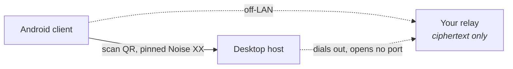

<div align="center">

# RemoteDexter

**View and control your desktop from an Android phone — over an encrypted session you start, on hardware you own.**

[](https://github.com/BaxtersLab/RemoteDexter/releases/latest)
[](LICENSE)


[**Download**](https://github.com/BaxtersLab/RemoteDexter/releases/latest) · [Quick start](#quick-start) · [Security](#security) · [Self-hosted relay](#going-off-lan-with-your-own-relay) · [Build from source](#building-from-source)

</div>

---

## Why RemoteDexter

Most remote-desktop tools run as always-on services, listen on the network from the moment they're installed, and route your session through someone else's servers. RemoteDexter takes the opposite position on each of those.

- **Nothing runs until you start it.** Installing the host creates no service, no autostart and no open port. It listens only after you choose a network interface and press **Start**.
- **Your phone pins your host.** Pairing uses a Noise XX handshake, and the phone remembers the host's identity — so nothing in between, including a relay, can impersonate it.
- **Viewing and control are separate permissions.** Seeing the screen never implies being able to type into it. The host denies every capability unless it is granted at launch, and nothing is remembered between launches.
- **No one else's infrastructure required.** Off your local network, the host dials out to a relay you run yourself. The relay forwards ciphertext and never holds a session key.

## How it works



On the same network, the phone connects straight to the host. Elsewhere, both ends connect outward to a relay that splices the two encrypted streams together — the handshake still runs end to end, so the relay sees only ciphertext.

## Download

Get the latest release from the **[Releases page](https://github.com/BaxtersLab/RemoteDexter/releases/latest)**.

| Package | Platform |
|---|---|
| `RemoteDexter-…-release.apk` | Android 8.0 or later (`arm64-v8a`, `armeabi-v7a`, `x86_64`) |
| `remotedexter_…_amd64.deb` | Linux host, `amd64` |
| `remotedexter-…-src.tar.gz` | Complete source for that release |

Every file ships with a `.sha256` checksum. The Android app is signed with a certificate whose SHA-256 fingerprint is published in each release's notes — **check it before installing, and expect every future release to carry the same one.**

A Windows host builds from source; prebuilt Windows binaries are not yet provided.

The 3.1.0.1 calibration hotfix needs both the updated phone app and host.
Updated peers negotiate resolution-independent pointer coordinates; an updated
host keeps native-size video for older clients. Updating only the phone does not
repair the coordinate mismatch in an older adaptive-resolution host. Cursor lift
is a separate preference and does not compensate for that mismatch.

## Quick start

### 1. Install the host

```bash
sudo apt install ./remotedexter_*_amd64.deb
```

Tested on Ubuntu 26.04 with GNOME 50 on Wayland.

### 2. Start it and pair

1. Launch **RemoteDexter** from your applications menu.
2. Choose a network interface and press **Start**.
3. Show the pairing QR code.
4. On your phone, install the APK, open RemoteDexter and scan the code.

Your desktop appears on the phone. Started from the menu, the host allows **viewing only**.

### 3. Allow control (optional)

1. Start the host from a terminal instead:
   ```bash
   RD_CAP_INPUT=1 remotedexter
   ```
2. In the host console, click **Enable input** once. Control works through a virtual input device at `/dev/uinput`, which ordinary users can't write to, so this step needs administrator rights. You can reverse it from the same console.
3. Grant control from the phone.

### Capabilities at a glance

| Grant | How | Default |
|---|---|---|
| View the screen | granted by the application launcher | on |
| Keyboard and mouse | `RD_CAP_INPUT=1`, plus **Enable input** once | off |
| Clipboard | `RD_CAP_CLIPBOARD=1` | off |

Grants are read at launch and never saved, so nothing can quietly widen them later.

## Going off-LAN with your own relay

The host can connect *out* to a relay instead of listening, so it works from behind NAT without opening a port on your router. `relayd` is part of this repository and is meant to be self-hosted.

**[docs/RUNNING_YOUR_OWN_RELAY.md](docs/RUNNING_YOUR_OWN_RELAY.md)** covers building and running it, both authentication methods, and exactly what a relay operator can and cannot observe.

## Security

- **[Threat model](docs/THREAT_MODEL.md)** — what is defended, what is not, and the residual risks this release ships with.
- **[Security hardening](SECURITY_HARDENING.md)** — the hardening decisions and the reasoning behind them.
- **[Relay visibility](docs/RUNNING_YOUR_OWN_RELAY.md)** — what a relay can see.

**Found a vulnerability?** Please report it privately through the repository's **[Security](https://github.com/BaxtersLab/RemoteDexter/security) tab → Report a vulnerability**, rather than opening a public issue. Reports reach the maintainer only.

## Known limitations

- **Screen lock.** While the host is locked, input and clipboard are refused. A phone that already holds control keeps it for up to five seconds after the lock, because lock state is polled rather than subscribed to.
- **Windows.** The host builds for Windows, but prebuilt Windows binaries are not yet published.

[`ROADMAP.md`](ROADMAP.md) lists things RemoteDexter deliberately declines to do, so a refusal isn't mistaken for a bug.

## Building from source

**Host** — Rust, stable toolchain:

```bash
cargo build --release -p host_app
./run.sh
```

`run.sh` is the supported launcher for a source build. Like the packaged launcher it grants viewing only; add `RD_CAP_INPUT=1` to allow control.

**Debian package:**

```bash
./scripts/build-deb.sh
```

No root and no network. The build refuses to produce a package if anything credential-shaped has been staged into it.

**Android client** — a standard Gradle project in `apk/`. The native library is built by `scripts/build_android_so.sh`. Release signing reads credentials from your environment and never from the tree; since an unsigned release build still succeeds, verify the result with `apksigner verify` rather than trusting the build's exit status.

## Licence

RemoteDexter is licensed under the **[GNU Affero General Public License v3.0 only](LICENSE)**.

The AGPL's network clause is what sets it apart from the GPL: if you modify RemoteDexter and let others use it over a network, you must offer them the source of *your* version. See [docs/SOURCE_OFFER.md](docs/SOURCE_OFFER.md). RemoteDexter is independently implemented, and third-party components it links against are listed in [docs/THIRD_PARTY_NOTICES.md](docs/THIRD_PARTY_NOTICES.md).
